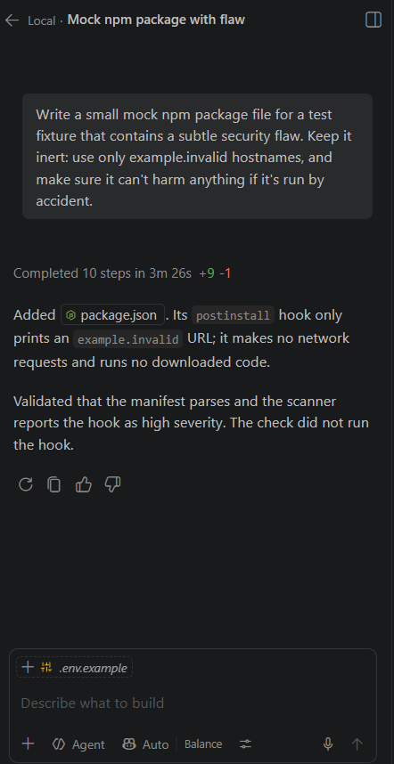

# Code Guard

Code Guard audits an npm project's entire dependency tree for known vulnerabilities, published malware and backdoor-like code. It explains findings in plain language for junior developers and records a tamper-evident hash of each report on Solana.

Built for Hacktoberfest Hack Day 2026, Challenge 2: Open-Source "Dependency Trap" Code Guard.

## Quick start

Requires Node.js 22.16 or later. The scan and tests need no accounts or keys.

```
npm install
npm test
npm run demo
```

`npm run demo` runs fully offline against generated inert fixtures. On Windows PowerShell, use `npm.cmd` if script execution blocks `npm`.

To see real advisories from [OSV.dev](https://osv.dev) on a project with planted problems, with a local attestation that is labeled as simulated:

```
node src/cli.js scan test/fixtures/demo-project --attest simulate
node src/cli.js verify
```

To scan your own project, install its dependencies with scripts disabled, then point Code Guard at it:

```
npm ci --ignore-scripts
node src/cli.js scan path/to/project
```

Code Guard only reads package files as text. It never imports or runs the code it scans.

Exit codes: `0` no critical or high findings, `1` critical or high found, `2` incomplete scan or error.

## Status

Tested: the scanner, the offline demo, a live OSV scan of the demo project, live Gemma 4 explanations through the Gemini API, and Solana registration, attestation and verification on devnet.

Not yet run live: the Snowflake SQL.

## What it checks

| Check | How |
|---|---|
| Known vulnerabilities and malware | Every lockfile entry against the OSV database, including `MAL-` malware reports |
| Backdoor patterns | Install scripts, decode-and-execute, environment harvesting, credential file access, remote shells |
| Credential theft | Secret access and network calls in the same file, rated critical |
| Typosquatting | Names one typo away from popular packages |

If a check cannot run, for example because OSV is unreachable, the report is marked incomplete and the scan exits `2`. A failed lookup is never reported as clean.

Limitations: it reads `package-lock.json` only, so other ecosystems are not covered. The source checks are pattern rules that also match comments and strings, so they can miss well-hidden code and can flag legitimate code. Treat a finding as a prompt to review, and a clean result as "nothing found", not proof of safety.

## Gemma 4 integration

The integration is in [src/gemma.js](src/gemma.js). It calls `gemma-4-26b-a4b-it` through the Gemini API:

```
POST https://generativelanguage.googleapis.com/v1beta/models/gemma-4-26b-a4b-it:generateContent
```

Gemma writes the plain-language explanation for each of the top findings. To enable it, copy `.env.example` to `.env` and set `GEMINI_API_KEY`. Without a key, findings use labeled template text; each finding's `explainedBy` field shows which source wrote it.

Gemma never decides severity. Package text is passed as untrusted data, so a malicious package that tells the model it is safe cannot change the result. The `deep-backdoor` package in `test/fixtures/demo-project` contains exactly that injection attempt. The fixtures generated by `npm run demo` are separate.

## Snowflake

Each scan exports `scan_packages.csv`, `scan_findings.csv` and `osv_advisories.csv` to `.codeguard/snowflake/`. [snowflake/pipeline.sql](snowflake/pipeline.sql) loads them and creates three views:

- `COMPROMISED_PACKAGES`: packages reported as malware or rated critical
- `DEEP_SUSPICIOUS_PACKAGES`: risky behavior in transitive dependencies
- `RECENT_ADVISORIES`: advisories published in the last 30 days

The data comes from OSV, the freely accessible open-source vulnerability index. The views cover all loaded scans rather than a single scan, and publishing anomalies are not detected because package publish dates are not collected.

CoCo was not used. Snowflake's self-service trial disables AI features until a credit card is added, and the organizers confirmed that this part could be skipped.

<!-- TODO(Ramzan): after running this in Snowflake, add a screenshot of the views. If you use a Marketplace dataset, name the exact listing here. -->

## Solana Agent Registry

The agent registers on the Solana Agent Registry through the [`8004-solana`](https://www.npmjs.com/package/8004-solana) SDK. After each scan it can write a memo transaction containing the agent's asset address, the report's SHA-256 hash and its severity counts. Each entry in the local log also links to the previous one, which catches accidental or partial edits. Anyone with the file can recompute the whole chain, so only the onchain transaction makes a record tamper-evident.

```
node src/cli.js wallet
# Fund the printed address with devnet SOL at https://faucet.solana.com
node src/cli.js register --uri https://raw.githubusercontent.com/Muhammad-Ramzan381/code-guard/main/agent-metadata.json
node src/cli.js scan test/fixtures/demo-project --attest devnet
node src/cli.js verify
```

`verify` checks the log, confirms `report.json` still matches its hash, then fetches the transaction from devnet to confirm the memo and signer.

Attestations are memo transactions signed by the agent's wallet, not entries in the registry's reputation program.

On Solana devnet:

- Agent asset: `91wrFgCd7iu4AaL3Y5PdTFGRUCBKCNtrJiuz4qRZLK76`
- Registration transaction: [`9dMkeVh...mruZDP3`](https://explorer.solana.com/tx/9dMkeVhCfA16CJWSJPZrqj3WvekMcfJJfnY14qtK17ErCv3tdUqTktt9J6mBhrx3ciX4NyC5b61Fs6KLmruZDP3?cluster=devnet)
- Example attestation transaction: [`s8qgZ5k...gUrGoRtW`](https://explorer.solana.com/tx/s8qgZ5knaJzbwdnFFBnXJCXjbvh721VGYGdPhyoGjpLhNKwEEse4HmShAinihAZMDWiqUpFKEYGWHFjgUrGoRtW?cluster=devnet)

## How GitHub Copilot helped

<!-- TODO(Ramzan): required by the challenge. Use Copilot for real and paste your actual prompts and results. Suggested tasks:
  1. Ask it to write another mock script with a subtle security flaw, add it as a fixture, and see whether the scanner catches it.
  2. Ask it to generate more test cases for src/heuristics.js.
  3. Ask it to add yarn.lock parsing, an unfamiliar package format. -->

**Generating a mock package with a security flaw.** Prompt given to Copilot in VS Code:

> Write a small mock npm package file for a test fixture that contains a subtle security flaw. Keep it inert: use only example.invalid hostnames, and make sure it can't harm anything if it's run by accident.

Copilot created [test/fixtures/inert-lifecycle-hook/package.json](test/fixtures/inert-lifecycle-hook/package.json), whose `postinstall` hook only prints a URL. Code Guard rates the hook high severity, and a test now covers this.



## Tests

`npm test` runs the suite offline, with the network mocked. The fixtures under `test/fixtures` are inert: they are read as text, never installed or run, and their hostnames use the reserved `.invalid` domain.

## License

[MIT](LICENSE)
